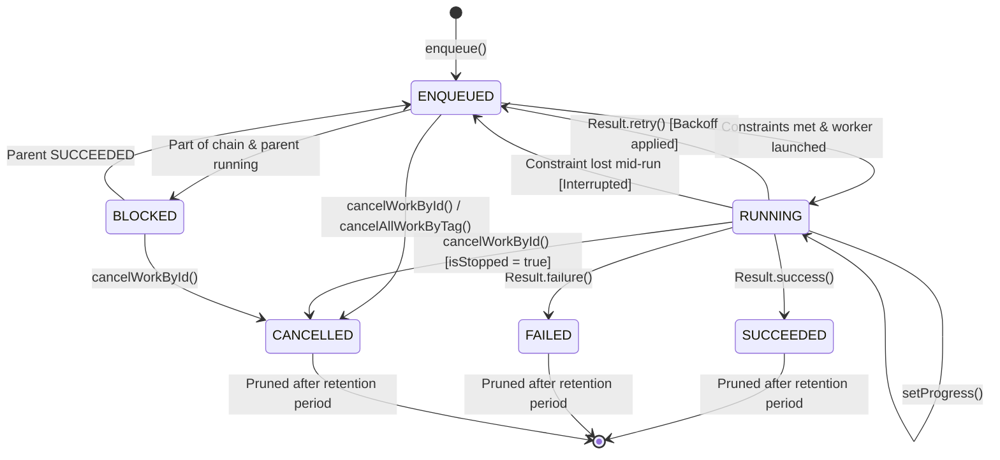

# WorkManager Internals & Advanced Architecture Interview Questions

A comprehensive technical reference detailing the internal architecture, OS dispatching mechanisms across API levels, database persistence layer, constraint tracking, execution engine, and specialized internals interview questions.

---

## PART 1: The Internal Architecture of WorkManager

### 1. Architectural Component Map

WorkManager is not a simple wrapper around a single system service. It is a layered subsystem composed of:
1. **Public Facade**: `WorkManager` & `WorkRequest` builders.
2. **Persistent Store**: `WorkDatabase` (SQLite via Room).
3. **Schedulers**: In-process `GreedyScheduler` + OS-level `SystemJobScheduler` / `SystemAlarmScheduler`.
4. **Reactive Constraints Engine**: `ConstraintTracker` & `ConstraintController`.
5. **Execution Engine**: `Processor` & `WorkerWrapper`.

```
+-----------------------------------------------------------------------------------+
|                               Your Application Code                              |
|          enqueue() / enqueueUniqueWork() / getWorkInfoByIdFlow()                  |
+-----------------------------------------------------------------------------------+
                                         │
                                         ▼
+-----------------------------------------------------------------------------------+
|                                 WorkManagerImpl                                   |
|                        (Singleton Process Orchestrator)                           |
+-------------------+-------------------------------------------+-------------------+
                    │                                           │
                    ▼                                           ▼
+---------------------------------------+   +---------------------------------------+
|             WorkDatabase              |   |               Schedulers              |
|        (Room / SQLite Storage)        |   |                                       |
|  • WorkSpec (core work definitions)   |   |  1. GreedyScheduler (In-process, live)|
|  • Dependency (parent-child chains)   |   |  2. SystemJobScheduler (API 23+)     |
|  • WorkTag (query/cancel by tags)     |   |  3. SystemAlarmScheduler (API 21-22) |
|  • WorkProgress (ephemeral progress)  |   |  4. GcmNetworkManager (Play Services) |
|  • SystemIdInfo (OS Job/Alarm IDs)    |   +-------------------+-------------------+
+-------------------+-------------------+                       │
                    │                                           │
                    ▼                                           ▼
+-----------------------------------------------------------------------------------+
|                         Processor & Execution Engine                              |
|  • WorkerWrapper (Executes Worker, handles cancellation, writes output to DB)    |
|  • WorkerFactory / HiltWorkerFactory (Instantiates Worker classes)                |
|  • ThreadPool / CoroutineScope (Dispatchers.Default)                              |
+-----------------------------------------------------------------------------------+
                                         │
                                         ▼
+-----------------------------------------------------------------------------------+
|                               Constraint Engine                                   |
|  • NetworkStateTracker (ConnectivityManager.NetworkCallback)                      |
|  • BatteryChargingTracker (ACTION_POWER_CONNECTED / DISCONNECTED)                 |
|  • BatteryNotLowTracker (ACTION_BATTERY_LOW / OKAY)                               |
|  • StorageNotLowTracker (ACTION_DEVICE_STORAGE_LOW / OKAY)                        |
|  • DeviceIdleTracker (PowerManager.isDeviceIdleMode)                              |
+-----------------------------------------------------------------------------------+
```

---

### 2. OS Dispatching Across Android API Levels

WorkManager dynamically adapts its scheduling backend depending on the host device's OS level and Google Play services availability:

```
┌───────────────────────────────────────┬────────────────────────────────────────────────────────┐
│ Android Version / API Level           │ Primary Underlying Scheduling Mechanism                │
├───────────────────────────────────────┼────────────────────────────────────────────────────────┤
│ API 23+ (Android 6.0 Marshmallow+)    │ JobScheduler (via SystemJobScheduler & SystemJobService│
│ API 21–22 (Lollipop) + Play Services  │ GcmNetworkManager (if available)                       │
│ API 21–22 (Lollipop) without Play Svcs│ SystemAlarmScheduler (AlarmManager + BroadcastReceiver)│
│ In-Process (App running & constraints)│ GreedyScheduler (Immediate thread execution)           │
└───────────────────────────────────────┴────────────────────────────────────────────────────────┘
```

#### A. API 23+ (`JobScheduler` Path)
* WorkManager creates a `JobInfo` object using `SystemJobScheduler`.
* Constraints (Network, Battery, Charging) are mapped directly to `JobInfo.Builder` APIs.
* **`setPersisted(true)`**: Crucial flag passed to `JobInfo`. The Android OS stores this job in `/data/system/job/jobs.xml`. When the device reboots, the OS automatically resurrects the scheduled jobs without requiring app initialization.
* When constraints match, OS invokes `SystemJobService.onStartJob()`, which hands execution to WorkManager's `Processor`.

#### B. API 21–22 (`AlarmManager` + `BroadcastReceiver` Path)
* Because `JobScheduler` did not exist or was severely limited before API 23, WorkManager schedules exact/inexact wakeups via `AlarmManager`.
* `AlarmManager` fires an Intent to `CommandHandler` / `SystemAlarmService`.
* `SystemAlarmService` manually inspects battery, network, and storage states.
* On device reboot, `RescheduleReceiver` intercepts `ACTION_BOOT_COMPLETED`, parses pending tasks from `WorkDatabase`, and re-registers the alarms.

#### C. `GreedyScheduler` (The Zero-Latency Optimizer)
* Whenever your application is active in memory and work is enqueued, `GreedyScheduler` evaluates constraints locally using `ConstraintTracker`.
* If all constraints are met immediately, it executes the Worker **without waiting for `JobScheduler` IPC round-trips**.
* If constraints are not met, `GreedyScheduler` registers listeners and also allows the OS scheduler to act as a fallback if the process gets killed.

---

### 3. Under the Hood: `WorkDatabase` (SQLite / Room)

WorkManager guarantees persistence by making **SQLite its absolute single source of truth**. Every mutation happens in an ACID transaction inside `/data/data/<package>/databases/androidx.work.workdb`.

#### Core Schema Tables:
1. **`WorkSpec`**: Primary table containing UUID, `worker_class_name`, `state` (`ENQUEUED`, `RUNNING`, `SUCCEEDED`, `FAILED`, `CANCELLED`, `BLOCKED`), `input`, `output`, `initial_delay`, `interval_duration`, `flex_duration`, `backoff_policy`, `backoff_delay_duration`, and constraints.
2. **`Dependency`**: Stores parent-child directed acyclic graph (DAG) relationships for chained work: `(work_spec_id, prerequisite_id)`.
3. **`WorkTag`**: Maps arbitrary string tags to work IDs for bulk querying/cancellation.
4. **`WorkProgress`**: Stores transient progress data emitted by `setProgress()`.
5. **`SystemIdInfo`**: Maps WorkManager UUIDs to OS-level `JobId` integers or `AlarmManager` RequestCodes.
6. **`Preference`**: Internal flags (e.g., last cleanup timestamp, reschedule flags).

---

### 4. The Complete Lifecycle of a WorkRequest



---

### 5. Constraint Tracking Engine: How OS Events Trigger Execution

Instead of polling the OS, WorkManager uses event-driven **`ConstraintTracker`** classes:
* **Network**: Registers `ConnectivityManager.registerNetworkCallback()` (API 24+) or a `BroadcastReceiver` for `CONNECTIVITY_ACTION` (API 21-23).
* **Battery**: Listens for `Intent.ACTION_BATTERY_LOW`, `Intent.ACTION_BATTERY_OKAY`, `Intent.ACTION_POWER_CONNECTED`, and `Intent.ACTION_POWER_DISCONNECTED`.
* **Storage**: Listens for `Intent.ACTION_DEVICE_STORAGE_LOW` and `Intent.ACTION_DEVICE_STORAGE_OK`.
* **Idle**: Queries `PowerManager.isDeviceIdleMode()` and listens for `ACTION_DEVICE_IDLE_MODE_CHANGED`.

When an OS event arrives:
1. The corresponding `ConstraintTracker` updates its cached state.
2. `ConstraintController` evaluates whether **all** constraints for active `WorkSpec`s are satisfied.
3. If satisfied $\rightarrow$ signals `Processor.startWork()`.
4. If a constraint is **lost** while a Worker is executing $\rightarrow$ signals `Processor.stopWork()`.

---

### 6. Cooperative Cancellation & Mid-Execution Constraint Loss

When a Worker is cancelled or its constraints drop:
1. `Processor` calls `WorkerWrapper.interrupt()`.
2. For **`Worker`**: `isStopped` is set to `true`, and `onStopped()` is invoked. If the worker runs a loop without inspecting `isStopped`, it leaks execution until the OS forcibly kills the process.
3. For **`CoroutineWorker`**: The parent `Job` inside WorkManager's coroutine scope is cancelled. Any suspending point (`delay()`, network call) immediately throws `CancellationException`.
4. WorkManager updates `WorkSpec.state`:
   - If user cancelled $\rightarrow$ `CANCELLED`.
   - If constraint was lost $\rightarrow$ reset back to `ENQUEUED` (to be retried once conditions return).

---

### 7. How `setProgress()` Works Reactively Without Polling

```
Worker: setProgress(workDataOf("PROGRESS" to 50))
   │
   ▼ (Async write)
Room WorkProgress Table: INSERT OR REPLACE INTO WorkProgress VALUES (id, data)
   │
   ▼
Room InvalidationTracker detects table mutation
   │
   ▼
Room Flow queries WorkSpec + WorkProgress
   │
   ▼
Flow<WorkInfo> emits new WorkInfo(state=RUNNING, progress=50%)
   │
   ▼
Jetpack Compose collectAsStateWithLifecycle() receives emission and recomposes UI
```
* No polling or IPC loops are used. WorkManager leverages SQLite triggers and Room's `InvalidationTracker` table monitoring.
* Once the worker enters `SUCCEEDED` or `FAILED`, WorkManager removes the row from `WorkProgress`, as progress is transient.

---

## PART 2: Top 15 Deep Internals Interview Questions & Answers

### Q1: How does WorkManager avoid waking up the application process when constraints are not met?
**Answer:**
WorkManager offloads constraint monitoring to the Android Operating System:
* On API 23+, WorkManager translates your constraints into a system `JobInfo` and delegates it to the OS-level `JobScheduler`.
* The Android OS kernel and system services monitor hardware rails (WiFi chips, battery fuel gauge, charging IC).
* Your app's process remains **completely dead/dormant**.
* Only when the kernel verifies all conditions match does `JobScheduler` send an IPC to your app's `SystemJobService`, waking your process.

---

### Q2: What is `GreedyScheduler` and why doesn't WorkManager solely rely on `JobScheduler`?
**Answer:**
* `JobScheduler` is an OS system service requiring inter-process communication (IPC) via Binder. Scheduling a job through it incurs latency, batching delays, and overhead.
* `GreedyScheduler` is an internal, in-memory scheduler that runs **inside the app's own process**.
* When work is enqueued while the app is alive and constraints are already met, `GreedyScheduler` immediately executes the Worker on WorkManager's internal thread pool with zero IPC delay.
* It simultaneously registers the job with `JobScheduler` as a safety net in case the process is killed before execution finishes.

---

### Q3: Explain the internal Room database schema of WorkManager and what happens during app process death.
**Answer:**
WorkManager persists everything inside an internal Room database (`androidx.work.workdb`) with tables:
* `WorkSpec`: Main work metadata, status, payload, backoff.
* `Dependency`: Directed Acyclic Graph (DAG) for chained pipelines.
* `WorkTag`, `WorkProgress`, `SystemIdInfo`.

**During process death:**
1. The memory state is lost, but the database state remains committed to disk in SQLite WAL mode.
2. Because the job was registered with `JobScheduler` (with `setPersisted(true)`), the OS wakes the app when constraints are satisfied.
3. Upon restart, WorkManager reads `WorkSpec` rows where `state == ENQUEUED` or interrupted `RUNNING` rows, re-evaluates them, and resumes execution seamlessly.

---

### Q4: How does `JobInfo.setPersisted(true)` work under the hood, and why did older APIs need `RescheduleReceiver`?
**Answer:**
* On API 23+, `JobInfo.Builder.setPersisted(true)` instructs the OS system service to serialize the job descriptor into XML on the `/data/system/` disk partition. On reboot, the OS restores the job table automatically.
* On API 21–22, `AlarmManager` alarms reside strictly in volatile kernel memory; all alarms are wiped upon device reboot.
* Therefore, on API 21–22, WorkManager registers a manifest `BroadcastReceiver` (`RescheduleReceiver`) listening for `android.intent.action.BOOT_COMPLETED`. Upon reboot, it queries `WorkDatabase` for incomplete tasks and manually re-schedules alarms.

---

### Q5: What happens inside the OS and WorkManager when a constraint is lost mid-execution (e.g., WiFi disconnects during an UNMETERED task)?
**Answer:**
1. Hardware detects network disconnect $\rightarrow$ `ConnectivityManager` invokes `NetworkCallback.onLost()`.
2. WorkManager's `NetworkStateTracker` fires, updating `ConstraintController`.
3. `Processor.stopWork()` sends an interrupt to `WorkerWrapper`.
4. If running a `CoroutineWorker`, the coroutine's parent `Job.cancel()` is called; active suspending calls (`delay`, Retrofit, Room) throw `CancellationException`.
5. `doWork()` halts, `onStopped()` is triggered for manual resource release.
6. `WorkSpec.state` is set back to `ENQUEUED` in SQLite (not `FAILED`).
7. When WiFi reconnects, the constraint triggers again, re-running the Worker from the beginning.

---

### Q6: How does WorkManager deliver real-time progress (`setProgress()`) to the UI without polling or service binding?
**Answer:**
1. Calling `setProgress(data)` inside a Worker executes an `INSERT OR REPLACE` query into the internal Room `WorkProgress` table.
2. Room utilizes SQLite table update hooks (`sqlite3_update_hook`) via `InvalidationTracker`.
3. Room's `InvalidationTracker` observes that `WorkProgress` was modified and triggers an emission on the Room Flow query backing `getWorkInfoByIdFlow()`.
4. The new `WorkInfo` containing the updated progress `Data` is emitted across the Flow directly to the UI's `collectAsStateWithLifecycle()`.

---

### Q7: How does WorkManager manage chained jobs and parallel joins under the hood?
**Answer:**
WorkManager models chained work as a **Directed Acyclic Graph (DAG)** stored in the `Dependency` table:
* Child tasks are initially set to `state = BLOCKED`.
* When a parent task completes with `Result.success()`, an SQLite trigger/transaction inspects whether all prerequisite rows for the child in the `Dependency` table have reached `SUCCEEDED`.
* Once all parents succeed, the child is transitioned from `BLOCKED` to `ENQUEUED` and submitted to the scheduler.
* If parallel parents produce output, an `InputMerger` (`ArrayCreatingInputMerger` or `OverwritingInputMerger`) combines their output `Data` maps before handing them to the child.
* If any parent returns `Result.failure()`, all downstream dependent children are marked `FAILED` immediately without executing.

---

### Q8: What happens internally when an app is Force Stopped from Settings versus swiped away from Recents?
**Answer:**
* **Swiped from Recents**: Only the UI process/activity task is dismissed. WorkManager's scheduled `JobScheduler` jobs, database, and background workers continue running unimpeded.
* **Force Stopped from Settings**:
  * The Linux kernel sets the app package state to `FLAG_STOPPED`.
  * The OS clears all pending `AlarmManager` alarms and unregisters all `JobScheduler` jobs registered by that package.
  * No broadcasts (`BOOT_COMPLETED`, network changes) will be delivered to the app.
  * WorkManager is **completely silenced** until the user explicitly taps the app icon to relaunch it. Upon launch, WorkManager reconciles its database with the OS scheduler.

---

### Q9: How does WorkManager calculate backoff delays internally?
**Answer:**
When a worker returns `Result.retry()`, WorkManager increments `WorkSpec.run_attempt_count` and calculates the delay:
* **`BackoffPolicy.LINEAR`**:
  $$\text{Delay} = \text{initialDelay} \times \text{runAttemptCount}$$
* **`BackoffPolicy.EXPONENTIAL`**:
  $$\text{Delay} = \text{initialDelay} \times 2^{\text{runAttemptCount} - 1}$$
* The calculated delay is clamped to a minimum of 10 seconds and a maximum of 5 hours (`WorkRequest.MAX_BACKOFF_MILLIS`).
* WorkManager stores the target execution timestamp in `WorkSpec.period_start_time` and schedules the next attempt with the OS scheduler.

---

### Q10: Why is reflection used by default in `WorkerFactory` and how does `HiltWorkerFactory` replace it?
**Answer:**
* By default, WorkManager stores only the class name string (`"com.example.MyWorker"`) in SQLite. To instantiate it, `DefaultWorkerFactory` calls:
  `Class.forName(className).getDeclaredConstructor(Context::class.java, WorkerParameters::class.java).newInstance(context, params)`
* This reflection fails if the Worker needs additional constructor arguments (like Repositories).
* `HiltWorkerFactory` uses code generation: `@HiltWorker` generates an assisted injection factory. When WorkManager requests a worker instance, Hilt's factory intercepts the class name and resolves constructor parameters from Dagger's dependency graph.

---

### Q11: How does WorkManager handle execution quotas for Expedited Work on Android 12+?
**Answer:**
* Android 12 (API 31) limits background foreground services. Expedited Work bypasses background restrictions using OS quotas tied to **App Standby Buckets** (Active, Working Set, Frequent, Rare).
* If an app has quota available, `SystemJobScheduler` schedules the job with `JobInfo.Builder.setExpedited(true)`.
* If the app exhausts its quota:
  * If configured with `OutOfQuotaPolicy.RUN_AS_NON_EXPEDITED_WORK_REQUEST`, WorkManager removes the expedited flag and downgrades it to a standard deferred job.
  * If configured with `OutOfQuotaPolicy.DROP_WORK_REQUEST`, WorkManager cancels execution and marks the request `CANCELLED`.

---

### Q12: What is `WorkerWrapper` and what is its role between `Processor` and `doWork()`?
**Answer:**
`WorkerWrapper` implements `Runnable` and is the **execution harness** for a Worker:
1. It runs on a background `Executor`.
2. It checks if the `WorkSpec` was already cancelled before starting.
3. It asks `WorkerFactory` to instantiate the Worker.
4. It sets the database state to `RUNNING`.
5. It invokes `doWork()`.
6. Upon completion, it validates the returned `Result`: writes output `Data` to SQLite, transitions state to `SUCCEEDED`/`FAILED`, triggers downstream dependencies, and unregisters constraints.

---

### Q13: How does WorkManager handle database pruning and cleanup of old `WorkSpec` entries?
**Answer:**
* If completed work remained in SQLite indefinitely, the database would grow unbounded.
* WorkManager defines a retention period (default **1 day** for finished work, configurable via `minimum_retention_duration`).
* `PruneWorkRunnable` executes periodically to prune rows in `SUCCEEDED`, `FAILED`, or `CANCELLED` states once their retention window expires and no active dependents rely on their output data.

---

### Q14: Why is there a strict 10KB limit on WorkManager `Data` payloads?
**Answer:**
1. **SQLite Cursor Window Limit**: Storing large blobs causes Android SQLite `CursorWindowAllocationException` when reading back rows.
2. **IPC Binder Limits**: WorkManager must pass input/output parameters across process boundaries to `JobScheduler` and `SystemJobService` using `PersistableBundle`. Android enforces a strict **1MB transaction buffer limit shared across all IPCs in the entire device**. Exceeding it throws `TransactionTooLargeException`.
3. To protect system stability, `Data.MAX_DATA_BYTES` is clamped to 10,240 bytes (10KB). Large payloads must be stored in files or databases, passing only URIs.

---

### Q15: How does WorkManager implement `setForeground()` for long-running workers under the hood?
**Answer:**
1. When a worker calls `setForeground(ForegroundInfo(notificationId, notification))`, WorkManager intercepts this in `Processor`.
2. It starts internal `androidx.work.impl.foreground.SystemForegroundService`.
3. `SystemForegroundService.startForeground(id, notification)` is called within the required 5-second OS window, satisfying Android's foreground service policy.
4. This removes the 10-minute background execution timeout, granting the worker foreground priority until `doWork()` finishes or is cancelled.
