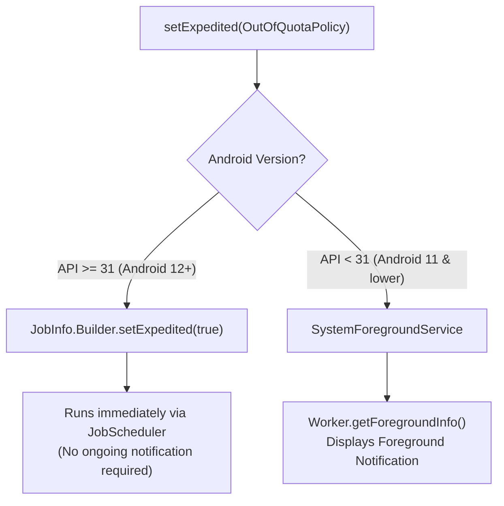

# Phase 2 Complete Reference: WorkManager Use Cases, Implementation Details & Interview Questions

A comprehensive technical reference detailing all 7 Phase 2 Worker implementations, real-world industry use cases, architectural data flows, edge cases, and targeted interview questions with in-depth answers.

---

## Quick Navigation

1. [Sub-task 2.1: `SyncLogsWorker` (One-Time Work, Constraints & Cooperative Cancellation)](#sub-task-21-synclogsworker)
2. [Sub-task 2.2: `ImageCompressWorker` (Input/Output Data, 10KB Limit Pattern & Live Progress)](#sub-task-22-imagecompressworker)
3. [Sub-task 2.3: `DailyCleanupWorker` (Periodic Work, 15-Minute Rule & Flex Windows)](#sub-task-23-dailycleanupworker)
4. [Sub-task 2.4: `CriticalAlertWorker` (Expedited Work, Out-of-Quota Policies & API < 31 Fallback)](#sub-task-24-criticalalertworker)
5. [Sub-task 2.5: Chained Pipeline (`DownloadWorker` + `FilterWorker` → `CombineAndUploadWorker`)](#sub-task-25-chained-pipeline-workers)
6. [Sub-task 2.6: `AnalyticsSyncWorker` (Unique Work Conflict Policies & Exponential Backoff)](#sub-task-26-analyticssyncworker)
7. [Sub-task 2.7: `VideoExportWorker` (Long-Running Worker, Foreground Service & Notification Management)](#sub-task-27-videoexportworker)

---

## Sub-task 2.1: `SyncLogsWorker`

### 1. Overview & Real-World Use Case
* **Class**: [`SyncLogsWorker.kt`](file:///c:/Users/Varsha/Documents/WorkSpcace/Jetpack_Compose_Trainng_Sources_Code/WorkManagerDemo/app/src/main/java/com/example/workmanagerdemo/workers/SyncLogsWorker.kt)
* **Real-World Use Case**:
  In production apps, diagnosing crashes, slow network requests, and user sessions requires capturing diagnostic logs. Storing logs in memory or a local file and flushing them to an observability server (Datadog, Firebase Crashlytics, Sentry) must happen **only when the device has an unmetered network connection and is charging**, so background uploads never drain user data or battery.
* **Core APIs**: `OneTimeWorkRequestBuilder`, `Constraints.Builder()`, `setRequiredNetworkType()`, `setRequiresCharging()`, `setRequiresBatteryNotLow()`, `isStopped`, `onStopped()`.

### 2. Architecture & Data Flow
```
[User Action / App Event]
           │
           ▼
[OneTimeWorkRequestBuilder<SyncLogsWorker>]
           │ (Constraints: Network=CONNECTED, Charging=true, BatteryNotLow=true)
           ▼
[WorkManager.enqueueUniqueWork(REPLACE)]
           │
           ▼ (Persisted to WorkDatabase Room SQLite)
┌────────────────────────────────────────────────────────┐
│ OS Constraint Tracker                                 │
│ ConnectivityManager + BatteryManager monitor hardware │
└──────────────────────────┬─────────────────────────────┘
                           │ (All constraints met)
                           ▼
                  [SyncLogsWorker.doWork()]
                  ├── Check isStopped
                  ├── Step 1: Collect in-memory logs
                  ├── Step 2: Serialise to payload
                  ├── Step 3: Upload to remote server
                  └── return Result.success(outputData)
```

### 3. Key Implementation Details
* **`CoroutineWorker` vs `Worker`**: `doWork()` is suspending; WorkManager runs it on `Dispatchers.Default` automatically.
* **Cooperative Cancellation**:
  WorkManager does not kill threads abruptly. Instead, it cancels the coroutine `Job`. Suspending points (`delay()`, network calls) immediately throw `CancellationException`. We also inspect `if (isStopped)` before each non-suspending step to avoid wasted CPU.
* **Tags**: Tagged with `WorkerConstants.TAG_SYNC_LOGS` allowing grouped cancellation (`cancelAllWorkByTag`).

### 4. Edge Cases Handled
* **Mid-execution Network Loss**: If WiFi disconnects while uploading, `ConnectivityManager.NetworkCallback` signals `Processor`. WorkManager interrupts the worker, resets the state back to `ENQUEUED` in SQLite, and retries when network returns.

---

### 5. Main Interview Questions for Sub-task 2.1

#### Q1: What happens if a constraint is lost while `doWork()` is actively executing?
**Answer**:
WorkManager's `ConstraintTracker` detects the event (e.g. WiFi dropped). `Processor` invokes `WorkerWrapper.interrupt()`. For a `CoroutineWorker`, the underlying coroutine `Job` is cancelled, causing any suspending call to throw `CancellationException`. The work is **not marked as FAILED**; instead, WorkManager resets its state in the database back to **`ENQUEUED`** so it can re-run automatically when conditions are satisfied again.

#### Q2: What is cooperative cancellation and why must developers check `isStopped`?
**Answer**:
In Java/Kotlin, threads cannot be safely killed from the outside (`Thread.stop()` is deprecated and dangerous). WorkManager uses **cooperative cancellation**: it sets a flag `isStopped = true` and cancels the coroutine `Job`. If a worker performs heavy non-suspending CPU work (e.g., image parsing in a `while` loop), it will keep running unless the developer explicitly checks `if (isStopped) break` inside the loop.

---

## Sub-task 2.2: `ImageCompressWorker`

### 1. Overview & Real-World Use Case
* **Class**: [`ImageCompressWorker.kt`](file:///c:/Users/Varsha/Documents/WorkSpcace/Jetpack_Compose_Trainng_Sources_Code/WorkManagerDemo/app/src/main/java/com/example/workmanagerdemo/workers/ImageCompressWorker.kt)
* **Real-World Use Case**:
  In messaging, e-commerce, or social media apps (WhatsApp, Instagram), users attach high-resolution 4K photos. Uploading raw 10MB images consumes excessive mobile data and causes timeouts. The app offloads image compression to WorkManager in the background, reporting live percentage progress to the UI while ensuring the 10KB Data limit is never violated.
* **Core APIs**: `Data`, `workDataOf`, `inputData`, `setProgress()`, `getWorkInfoByIdFlow()`, `Result.success(outputData)`.

### 2. Architecture & The 10KB Limit Pattern
```
[Input Data: File URI + Quality Factor] (Size < 1 KB)
                   │
                   ▼
       [ImageCompressWorker.doWork()]
                   │
         [Compresses Bitmap]
                   │
                   ▼
  Writes to context.cacheDir/compressed_images/
  (Raw file size = 1.2 MB on disk)
                   │
                   ▼
 [Output Data: File URI String + Size Metadata] (Size < 1 KB)
                   │
                   ▼
         [Result.success(outputData)]
```

### 3. Key Implementation Details
* **The 10KB Rule**: `androidx.work.Data` has a hard limit of `Data.MAX_DATA_BYTES` (10,240 bytes) because it is stored in SQLite and passed across Binder IPC. We **never** store Bitmaps or byte arrays in `Data`. We store the file on disk and pass only the file URI string.
* **Reactive Progress (`setProgress`)**:
  Calling `setProgress(workDataOf(...))` writes to the internal Room `WorkProgress` table. Room's `InvalidationTracker` notifies `getWorkInfoByIdFlow()`, which updates Compose `collectAsStateWithLifecycle()` without polling.

---

### 4. Main Interview Questions for Sub-task 2.2

#### Q1: Why does WorkManager enforce a strict 10KB limit on `Data` objects and how should you pass large files?
**Answer**:
1. **SQLite CursorWindow Limits**: Storing large blobs in the `WorkSpec` table causes `CursorWindowAllocationException` when Room queries rows.
2. **Binder Transaction Buffer Limits**: WorkManager communicates with system services (`JobScheduler`) across IPC. Android has a shared 1MB Binder transaction buffer for the entire device; large payloads throw `TransactionTooLargeException`.
**Solution**: Store large payloads (bitmaps, files, lists) on disk (`cacheDir` or Room DB) and pass only the primary key or file path string in the `Data` map.

#### Q2: What is the lifecycle of progress data set via `setProgress()`?
**Answer**:
Progress data is **transient and ephemeral**. It is only stored in the `WorkProgress` table while the worker is in the `RUNNING` state. As soon as the worker terminates (`SUCCEEDED`, `FAILED`, or `CANCELLED`), WorkManager deletes the row from `WorkProgress`. Final results must always be returned in `Result.success(outputData)`.

---

## Sub-task 2.3: `DailyCleanupWorker`

### 1. Overview & Real-World Use Case
* **Class**: [`DailyCleanupWorker.kt`](file:///c:/Users/Varsha/Documents/WorkSpcace/Jetpack_Compose_Trainng_Sources_Code/WorkManagerDemo/app/src/main/java/com/example/workmanagerdemo/workers/DailyCleanupWorker.kt)
* **Real-World Use Case**:
  Apps accumulate temporary cache files, partial HTTP downloads, and transient media thumbnails. A `PeriodicWorkRequest` executes once every 24 hours to delete obsolete files older than 3 days, reclaiming device storage without interfering with user interactions.
* **Core APIs**: `PeriodicWorkRequestBuilder`, `ExistingPeriodicWorkPolicy`, `MIN_PERIODIC_INTERVAL_MILLIS`, `MIN_PERIODIC_FLEX_MILLIS`.

### 2. Architecture: The 15-Minute Rule & Flex Window
```
|<──────────────────── Repeat Interval: 15 minutes ────────────────────>|
|                  Idle Window                  |      Flex Window      |
|                 (10 minutes)                  |      (5 minutes)      |
0m                                             10m                     15m
                                                ▲                       ▲
                                                └─── OS can run job ────┘
                                                     at any point here
```

### 3. Key Implementation Details
* **Minimum Intervals**:
  * Repeat interval $\ge 15\text{ minutes}$ (`PeriodicWorkRequest.MIN_PERIODIC_INTERVAL_MILLIS`).
  * Flex interval $\ge 5\text{ minutes}$ (`PeriodicWorkRequest.MIN_PERIODIC_FLEX_MILLIS`).
* **The Periodic Lifecycle Paradox**:
  Periodic work **never reaches `SUCCEEDED`**. When `DailyCleanupWorker` returns `Result.success()`, WorkManager resets its state in the database back to **`ENQUEUED`** and calculates the next execution window ($T_{\text{next}} = T_{\text{current}} + \text{interval}$).
* **`ExistingPeriodicWorkPolicy`**:
  * `UPDATE`: Updates interval/constraints without resetting the elapsed timer.
  * `KEEP`: Preserves the currently scheduled timer and ignores the new request.
  * `CANCEL_AND_REENQUEUE`: Cancels the existing periodic job and resets the timer to 0.

---

### 4. Main Interview Questions for Sub-task 2.3

#### Q1: Can a `PeriodicWorkRequest` be chained using `.then()`?
**Answer**:
**No**. Calling `workManager.beginWith(periodicRequest).then(otherRequest)` will throw an `IllegalArgumentException: PeriodicWorkRequests cannot be chained.`
* **Workaround**: If a periodic trigger must execute a sequence of tasks, schedule a `PeriodicWorkRequest` whose worker programmatically enqueues a `OneTimeWorkRequest` chain inside `doWork()`.

#### Q2: What happens if you pass a repeat interval of 5 minutes to `PeriodicWorkRequestBuilder`?
**Answer**:
WorkManager will not throw an exception; instead, it will log a warning and **automatically clamp the interval to the 15-minute system minimum** (`PeriodicWorkRequest.MIN_PERIODIC_INTERVAL_MILLIS`).

---

## Sub-task 2.4: `CriticalAlertWorker`

### 1. Overview & Real-World Use Case
* **Class**: [`CriticalAlertWorker.kt`](file:///c:/Users/Varsha/Documents/WorkSpcace/Jetpack_Compose_Trainng_Sources_Code/WorkManagerDemo/app/src/main/java/com/example/workmanagerdemo/workers/CriticalAlertWorker.kt)
* **Real-World Use Case**:
  High-priority tasks that cannot wait for OS deferral windows: receiving a critical security alert, sending an emergency SOS broadcast, or handling an incoming high-priority VoIP / messaging handshake where immediate execution is mandatory.
* **Core APIs**: `setExpedited()`, `OutOfQuotaPolicy`, `getForegroundInfo()`, `ForegroundInfo`.

### 2. Architecture & Version Forking


### 3. Key Implementation Details
* **Android 12+ Background FGS Ban**: Starting in Android 12 (API 31), apps cannot launch foreground services while running in the background. Expedited Work is Google's sanctioned alternative.
* **Mandatory `getForegroundInfo()`**:
  On Android 11 and lower, WorkManager emulates expedited work by running as a Foreground Service. If `getForegroundInfo()` is omitted, WorkManager **crashes with an `IllegalStateException`** on older devices.
* **`OutOfQuotaPolicy`**:
  * `RUN_AS_NON_EXPEDITED_WORK_REQUEST`: If the app exhausts its App Standby Bucket quota, it gracefully downgrades into a standard deferred job.
  * `DROP_WORK_REQUEST`: Immediately cancels and drops the request if quota is depleted.

---

### 4. Main Interview Questions for Sub-task 2.4

#### Q1: Why does `setExpedited()` require overriding `getForegroundInfo()` even on Android 12+?
**Answer**:
Because an app can be installed on devices running older Android versions (API < 31). On Android 11 and lower, the OS lacks native expedited job scheduler support, so WorkManager falls back to a **Foreground Service** with an ongoing notification. If `getForegroundInfo()` is missing, WorkManager cannot create the notification and throws a runtime `IllegalStateException`.

#### Q2: What are App Standby Buckets and how do they affect Expedited Work?
**Answer**:
The OS places apps into buckets (Active, Working Set, Frequent, Rare) based on how recently and frequently the user opened them. Each bucket receives a daily execution quota for expedited jobs. When an app in the "Rare" bucket exhausts its quota, WorkManager consults `OutOfQuotaPolicy`: either downgrading the task to normal deferred execution or dropping it completely.

---

## Sub-task 2.5: Chained Pipeline Workers

### 1. Overview & Real-World Use Case
* **Workers**:
  * [`DownloadWorker.kt`](file:///c:/Users/Varsha/Documents/WorkSpcace/Jetpack_Compose_Trainng_Sources_Code/WorkManagerDemo/app/src/main/java/com/example/workmanagerdemo/workers/DownloadWorker.kt) (Node A)
  * [`FilterWorker.kt`](file:///c:/Users/Varsha/Documents/WorkSpcace/Jetpack_Compose_Trainng_Sources_Code/WorkManagerDemo/app/src/main/java/com/example/workmanagerdemo/workers/FilterWorker.kt) (Node B)
  * [`CombineAndUploadWorker.kt`](file:///c:/Users/Varsha/Documents/WorkSpcace/Jetpack_Compose_Trainng_Sources_Code/WorkManagerDemo/app/src/main/java/com/example/workmanagerdemo/workers/CombineAndUploadWorker.kt) (Node C)
* **Real-World Use Case**:
  Data ETL (Extract, Transform, Load) pipelines: An app downloads raw data from Server A, concurrently compiles user filter preferences in memory, and once **both** parallel tasks finish, merges them into a clean report and uploads it to Cloud Storage.
* **Core APIs**: `WorkContinuation`, `beginWith()`, `then()`, `InputMerger`, `OverwritingInputMerger`, `ArrayCreatingInputMerger`.

### 2. Architecture & DAG Join
```
      [Node A: DownloadWorker]        [Node B: FilterWorker]
      (Outputs: downloaded_uri)       (Outputs: filtered_data)
                 │                               │
                 └───────────────┬───────────────┘
                                 │ OverwritingInputMerger
                                 ▼
                     [Node C: CombineAndUpload]
                     (Merges downloaded_uri + filtered_data)
                                 │
                                 ▼
                      [Cloud Storage Endpoint]
```

### 3. Key Implementation Details
* **Directed Acyclic Graph (DAG)**:
  `workManager.beginWith(listOf(downloadWork, filterWork)).then(combineWork).enqueue()`
  Node C starts in the **`BLOCKED`** state. When both A and B reach `SUCCEEDED`, WorkManager updates SQLite and transitions Node C to `ENQUEUED` $\rightarrow$ `RUNNING`.
* **Failure Propagation**:
  If Node A returns `Result.failure()`, WorkManager inspects the `Dependency` table and immediately marks Node C as **`FAILED`**. Node C is **never instantiated or executed**, conserving battery and network bandwidth.

---

### 4. Main Interview Questions for Sub-task 2.5

#### Q1: What is the difference between `OverwritingInputMerger` and `ArrayCreatingInputMerger`?
**Answer**:
When parallel workers join into a downstream worker:
* **`OverwritingInputMerger`** *(Default)*: If both parent tasks output a key with the same name (e.g. `"status"`), the value from the last worker to complete overwrites the previous value.
* **`ArrayCreatingInputMerger`**: If both parent tasks output the same key, WorkManager combines them into an array of that type (e.g., individual `String` outputs become `Array<String>`).

#### Q2: What happens to downstream dependent workers if an upstream worker calls `Result.retry()`?
**Answer**:
Downstream workers remain in the **`BLOCKED`** state. They do not fail; they wait until the upstream worker successfully completes on a subsequent retry attempt before they are unblocked.

---

## Sub-task 2.6: `AnalyticsSyncWorker`

### 1. Overview & Real-World Use Case
* **Class**: [`AnalyticsSyncWorker.kt`](file:///c:/Users/Varsha/Documents/WorkSpcace/Jetpack_Compose_Trainng_Sources_Code/WorkManagerDemo/app/src/main/java/com/example/workmanagerdemo/workers/AnalyticsSyncWorker.kt)
* **Real-World Use Case**:
  User tracking and telemetry batching: As users navigate through screens, the app logs analytics events. Calling `enqueueUniqueWork` prevents multiple parallel uploads from racing against each other. If the server is temporarily overloaded (HTTP 503), the task backs off exponentially to avoid server throttling.
* **Core APIs**: `enqueueUniqueWork`, `ExistingWorkPolicy`, `setBackoffCriteria()`, `BackoffPolicy`, `runAttemptCount`.

### 2. Architecture & The 4 Conflict Policies

```
When Work A is active and Work B arrives with the same unique name:
```

| Policy | What Happens to Work A? | What Happens to Work B? |
|---|---|---|
| **`KEEP`** | Keeps running | **Discarded** completely |
| **`REPLACE`** | **Cancelled** immediately | Enqueued and runs immediately |
| **`APPEND`** | Keeps running | Chained to run **after** Work A finishes |
| **`APPEND_OR_REPLACE`** | Keeps running | Chained after A; if A failed/cancelled, B replaces it |

### 3. Backoff Math
* **Exponential Backoff**: $\text{Delay} = \text{initialDelay} \times 2^{(\text{runAttemptCount} - 1)}$ (e.g. $10\text{s}, 20\text{s}, 40\text{s}, 80\text{s} \dots$)
* **Linear Backoff**: $\text{Delay} = \text{initialDelay} \times \text{runAttemptCount}$ (e.g. $10\text{s}, 20\text{s}, 30\text{s}, 40\text{s} \dots$)
* Capped between 10 seconds and 5 hours.

---

### 4. Main Interview Questions for Sub-task 2.6

#### Q1: What is the difference between `APPEND` and `APPEND_OR_REPLACE`?
**Answer**:
Under **`APPEND`**, if the currently running task (Work A) fails or is cancelled, the newly appended task (Work B) **also fails** and will never run. Under **`APPEND_OR_REPLACE`**, if Work A fails or was cancelled, Work B is not failed—it replaces Work A and runs freshly as an independent new request.

#### Q2: How can you prevent a worker from retrying indefinitely on `Result.retry()`?
**Answer**:
Inspect `runAttemptCount` inside `doWork()`:
```kotlin
if (runAttemptCount >= 3) {
    return Result.failure(workDataOf("error" to "Exceeded max retries"))
} else {
    return Result.retry()
}
```

---

## Sub-task 2.7: `VideoExportWorker`

### 1. Overview & Real-World Use Case
* **Class**: [`VideoExportWorker.kt`](file:///c:/Users/Varsha/Documents/WorkSpcace/Jetpack_Compose_Trainng_Sources_Code/WorkManagerDemo/app/src/main/java/com/example/workmanagerdemo/workers/VideoExportWorker.kt)
* **Real-World Use Case**:
  Media editing, video transcoding, or large file backup: A 1080p or 4K video render takes 15–30 minutes. Normal workers are killed by the Android OS after ~10 minutes. Promoting the worker to a **Foreground Service** using `setForeground()` allows extended execution and provides an ongoing notification with a "Cancel" action button.
* **Core APIs**: `setForeground()`, `ForegroundInfo`, `createCancelPendingIntent()`, `onStopped()`.

### 2. Architecture & Foreground Service Promotion
```
[VideoExportWorker.doWork()]
           │
           ▼
[setForeground(createForegroundInfo(progress))]
           │
           ▼
[WorkManager starts internal SystemForegroundService]
           │
           ▼
┌────────────────────────────────────────────────────────┐
│ Android System Notification Tray                      │
│ Ongoing notification with live progress bar + [CANCEL]│
└────────────────────────────────────────────────────────┘
           │
           ▼
[OS 10-Minute Timeout is Removed! Task runs to completion]
```

### 3. Key Implementation Details
* **Bypassing the 10-Minute Timeout**: Calling `setForeground()` delegates the task to WorkManager's internal `SystemForegroundService`, removing the execution timeout.
* **Native Notification Cancel Action**:
  ```kotlin
  val cancelPendingIntent = WorkManager.getInstance(context)
      .createCancelPendingIntent(id)
  ```
  Attaching this `PendingIntent` to the notification allows the user to cancel the export directly from the system tray.
* **Clean-up in `onStopped()`**:
  If cancelled mid-transcode, `onStopped()` deletes partial output files so corrupted video fragments do not consume user disk space.

---

### 4. Main Interview Questions for Sub-task 2.7

#### Q1: What is the 10-minute execution limit in WorkManager and how do you bypass it?
**Answer**:
By default, the Android OS imposes a ~10 minute background execution window on workers (`JobService` execution limit). If a worker exceeds this, the OS stops it. To bypass this for long tasks (e.g. video rendering, large file downloads), the worker must call **`setForeground(foregroundInfo)`**. WorkManager promotes the worker to a **Foreground Service**, removing the 10-minute timeout.

#### Q2: What happens if a user taps the "Cancel" button on a Foreground Worker notification?
**Answer**:
The `createCancelPendingIntent(id)` fires an OS Intent to WorkManager's `CancelWorkRunnable`. WorkManager cancels the worker's coroutine `Job`, stops the `SystemForegroundService`, dismisses the notification, and calls **`onStopped()`** on the worker for resource cleanup.

---

## Summary Matrix of All 7 Workers

| Sub-task | Worker Class | Primary Mechanism | Terminal Behavior | Key Interview Focus |
|---|---|---|---|---|
| **2.1** | `SyncLogsWorker` | `OneTimeWorkRequestBuilder` + `Constraints` | `SUCCEEDED` / `FAILED` | Constraints & Cooperative Cancellation |
| **2.2** | `ImageCompressWorker` | `Data` + `setProgress()` | `SUCCEEDED` | 10KB Data Limit Pattern & Room InvalidationTracker |
| **2.3** | `DailyCleanupWorker` | `PeriodicWorkRequestBuilder` | `ENQUEUED` (Perpetual) | 15-Min Rule, Flex Windows & Self-Rescheduling |
| **2.4** | `CriticalAlertWorker` | `setExpedited()` + `OutOfQuotaPolicy` | `SUCCEEDED` | Android 12 FGS Ban & `getForegroundInfo()` Fallback |
| **2.5** | Chained Pipeline | `WorkContinuation` (`beginWith.then`) | `SUCCEEDED` / `FAILED` | DAG Joins, `InputMerger` & Failure Propagation |
| **2.6** | `AnalyticsSyncWorker` | `enqueueUniqueWork` + Backoff | `SUCCEEDED` / `FAILED` | Conflict Policies (`KEEP`, `REPLACE`, `APPEND`) & Backoff Math |
| **2.7** | `VideoExportWorker` | `setForeground()` (Foreground Service) | `SUCCEEDED` | Lifts 10-min Timeout & Notification Cancel Action |
